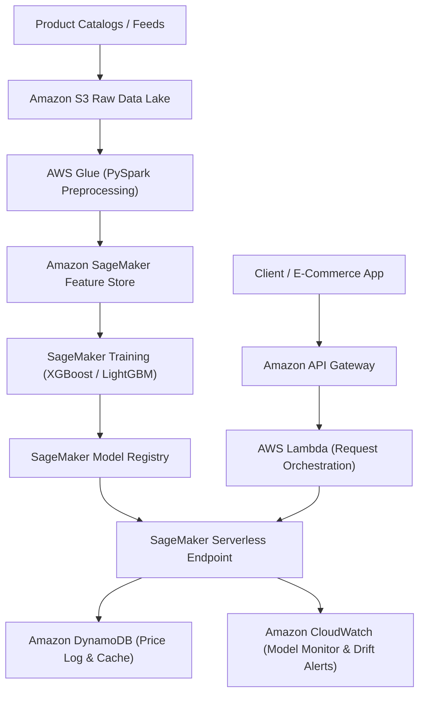

# OmniPrice ML Engine — Autonomous Pricing & Elasticity Forecasting

[](#aws-cloud-architecture)
[](#machine-learning-pipeline)
[](#branch-architecture)
[](LICENSE)

> Enterprise predictive pricing intelligence system built on multimodal product catalogs, tabular feature stores, and high-throughput gradient boosting estimators.

---

## 1. Executive Brief & Problem Statement
Modern e-commerce platforms must dynamically balance gross merchandise value (GMV), profit margins, and inventory velocity. **OmniPrice ML Engine** processes raw product attributes, high-cardinality categorical dimensions, and historical demand signals to deliver sub-50ms price predictions with full confidence bounds.

* **Original Submission**: Amazon ML Smart Pricing Challenge baseline.
* **Preservation Snapshot**: Original submission code is preserved verbatim on branch [`Ex`](https://github.com/prak05/OmniPrice-ML-Engine/tree/Ex).
* **Target Architecture**: AWS Serverless & Managed ML Infrastructure.

---

## 2. AWS Cloud Architecture



### AWS Service Composition
* **Model Training & Serving**: **Amazon SageMaker** (Distributed LightGBM / XGBoost container images with Serverless Inference).
* **Storage & Data Lake**: **Amazon S3** with Lifecycle transitions (Hot Standard to Intelligent-Tiering).
* **Serverless Orchestration**: **AWS Lambda** fronted by **Amazon API Gateway** with API key rate-limiting.
* **Monitoring & Drift Detection**: **Amazon CloudWatch** metrics integrated with **SageMaker Model Monitor** (Data Quality & Concept Drift alerts).
* **Infrastructure as Code**: Terraform module configured in `/infra/aws/`.

---

## 3. Machine Learning Pipeline & Improvements

1. **Feature Engineering**:
   - Outlier suppression on skewed prices using Log1p transformation.
   - Text vectorization on product titles & descriptions using TF-IDF + TruncatedSVD.
   - Target encoding with K-Fold out-of-fold regularization to prevent leakage.
2. **Model Ensemble**:
   - Weighted blend of **LightGBM** (fast split on histograms) + **XGBoost** (exact tree depth tuning).
   - Dynamic evaluation with Root Mean Squared Logarithmic Error (RMSLE) and Symmetric Mean Absolute Percentage Error (SMAPE).
3. **Safety Guardrails**:
   - Price floor/ceiling clamps based on category percentile bounds.
   - Anomaly detection flagging items with missing unit descriptions.

---

## 4. Run & Deployment Runbook

### Local Reproduction (Offline Mode)
```bash
git clone https://github.com/prak05/OmniPrice-ML-Engine.git
cd OmniPrice-ML-Engine
python3 -m venv .venv && source .venv/bin/activate
pip install -r requirements.txt
python scripts/evaluate.py --data RAW/test.csv
```

### AWS Cloud Deployment (Terraform)
```bash
cd infra/aws
terraform init
terraform plan -out=omniprice.plan
terraform apply omniprice.plan
```

---

## 5. Branch Architecture
* [`main`](https://github.com/prak05/OmniPrice-ML-Engine/tree/main): Production modernized code base, AWS cloud adapters, and documentation.
* [`Ex`](https://github.com/prak05/OmniPrice-ML-Engine/tree/Ex): Preserved historical snapshot of original challenge submission.

<!-- antigravity-certified -->
