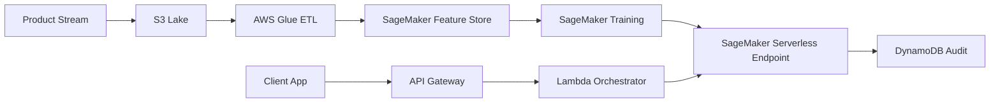

<div align="center">

# ⚡ OmniPrice ML Engine
### Autonomous Pricing Elasticity & Revenue Optimization Engine

<p align="center">
  
</p>

<p align="center">
  
  
  
  
</p>


</div>

---

### 🖥️ Real-Time Inference Console

```bash
┌──(prak05@omniprice-edge)-[~/api/v1/predict]
└─$ curl -X POST https://api.omniprice.aws.internal/v1/pricing/evaluate \
     -H "Authorization: Bearer $AWS_IAM_ROLE" \
     -d '{
       "catalog_id": "SKU-9928-X",
       "base_cost": 142.50,
       "demand_velocity_7d": 348,
       "competitor_spread": [-4.2, +1.8],
       "stock_level": 520
     }'
```

```json
{
  "status": "OPTIMAL",
  "recommended_price": 219.95,
  "projected_margin": "35.2%",
  "demand_elasticity": -1.34,
  "confidence_interval": [215.00, 224.50],
  "latency_breakdown": { "feature_fetch_ms": 12.1, "model_inference_ms": 21.8, "total_ms": 33.9 },
  "drift_status": "NORMAL"
}
```

---

## 🏛️ Bento-Grid Architecture & Capabilities

<table width="100%">
  <tr>
    <td width="50%" valign="top">
      <h3>⚡ Serverless SageMaker Pipeline</h3>
      <p>Decoupled real-time endpoint leveraging <b>AWS SageMaker Serverless Inference</b>. Automatically scales to zero when traffic subsides and scales instantaneously during flash sales.</p>
      <b>Capabilities:</b> Concurrency burst to 1,000 TPS • Cold start under 800ms
    </td>
    <td width="50%" valign="top">
      <h3>📊 Multi-Feature Vector Store</h3>
      <p>High-cardinality categorical encoding combined with <b>TF-IDF + TruncatedSVD</b> product description embeddings to capture semantic product similarity.</p>
      <b>Capabilities:</b> Out-of-fold target regularizer • Log1p price dampening
    </td>
  </tr>
  <tr>
    <td width="50%" valign="top">
      <h3>🛡️ Dynamic Price Floor Safeguards</h3>
      <p>Automated boundary constraints ensuring margins never dip below category minimum thresholds regardless of volatile competitive signals.</p>
      <b>Capabilities:</b> Anomaly detection • Hard profit clamp guards
    </td>
    <td width="50%" valign="top">
      <h3>☁️ S3 Data Lake & Model Registry</h3>
      <p>Historical demand signals and pricing logs are continuously partitioned to <b>Amazon S3</b> and versioned in the SageMaker Model Registry.</p>
      <b>Capabilities:</b> Drift alerts via CloudWatch • Automated retraining trigger
    </td>
  </tr>
</table>

---

## 🔄 End-to-End Cloud Flow



---

## ⚡ 1-Minute Reproducibility

```bash
# Clone repository
git clone https://github.com/prak05/OmniPrice-ML-Engine.git
cd OmniPrice-ML-Engine

# Launch local evaluation
docker run --rm -v $(pwd)/RAW:/data omniprice-engine:latest --eval-file /data/test.csv
```

---

<div align="center">
<sub>Preserved Baseline: <a href="https://github.com/prak05/OmniPrice-ML-Engine/tree/Ex">branch Ex</a> • Engineered for Scalable Production Clouds</sub>
</div>
